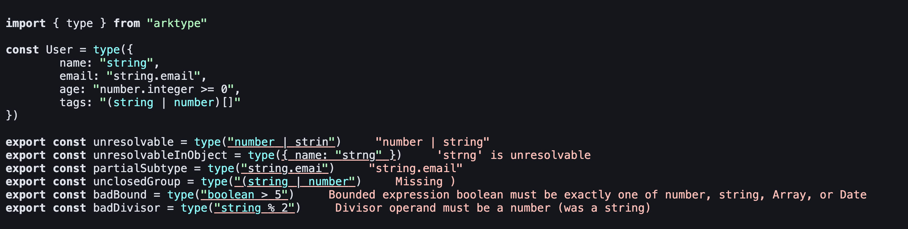

# arktype.nvim

ArkType's VS Code extension ([`ark/extension`](../extension)) for Neovim: the same highlighting inside definitions, the same one-line error summaries, completions while you type in strings, and auto-imports that pick ArkType's `type`.

| VS Code extension                                                             | arktype.nvim                                                                     |
| ----------------------------------------------------------------------------- | -------------------------------------------------------------------------------- |
| TextMate grammar injected into TS, TSX, JS, JSX, Svelte, Vue, Astro, Markdown | tree-sitter grammar ([`ark/tree-sitter`](../tree-sitter)) injected into the same |
| ErrorLens with 5 `errorLens.replace` rules                                    | the same rules, run by a port of JavaScript's regex engine                       |
| ErrorLens `followCursor: "closestProblem"`, no delay                          | the summary of the problem closest to the cursor, redrawn as diagnostics change  |
| `editor.quickSuggestions: { strings: "on" }`                                  | completions on each character typed in a string (built-in LSP completion)        |
| `autoImportSpecifierExcludeRegexes: ["^(node:)?os$"]` (docs)                  | added to vtsls and ts_ls for you                                                 |



<sub>Neovim's default colorscheme, with `follow_cursor = "allLines"` to show several summaries at once.</sub>

Both are tested against [`ark/editor-conformance`](../editor-conformance), the fixtures every ArkType editor integration is held to. See [Parity](#parity).

## Install

Needs Neovim 0.11 or later, a C compiler (or the [`tree-sitter` CLI](https://github.com/tree-sitter/tree-sitter/tree/master/crates/cli)) to build the parser, and parsers for the languages you write ArkType in, which [nvim-treesitter](https://github.com/nvim-treesitter/nvim-treesitter) (`main` branch) installs:

```vim
:TSInstall typescript tsx javascript
```

The plugin lives in the ArkType repo's `ark/neovim` directory, so each snippet adds that directory to `'runtimepath'`.

```lua lazy.nvim
{
	"arktypeio/arktype",
	name = "arktype.nvim",
	lazy = false,
	build = function(plugin)
		vim.opt.rtp:append(plugin.dir .. "/ark/neovim")
		require("arktype.treesitter").build()
	end,
	config = function(plugin)
		vim.opt.rtp:append(plugin.dir .. "/ark/neovim")
		require("arktype").setup()
	end
}
```

```lua vim.pack
vim.pack.add({ { src = "https://github.com/arktypeio/arktype", name = "arktype.nvim" } })
vim.opt.rtp:append(vim.fn.stdpath("data") .. "/site/pack/core/opt/arktype.nvim/ark/neovim")
require("arktype").setup()
```

```lua packer.nvim
use({
	"arktypeio/arktype",
	as = "arktype.nvim",
	rtp = "ark/neovim",
	config = function()
		require("arktype").setup()
	end
})
```

`setup()` builds the parser the first time, into `stdpath("data")/site/parser/arktype.so`. After an update, rebuild it with `:ArkTypeBuild` (lazy.nvim's `build` above does this for you) and restart Neovim. `:checkhealth arktype` shows what's working.

## Configuration

These are the defaults:

```lua
require("arktype").setup({
	-- inline error summaries, or false
	diagnostics = {
		-- "lens": a summary at the end of the line, as ErrorLens draws it
		-- "virtual_text" / "virtual_lines": vim.diagnostic's own, with the summary as their text
		display = "lens",
		-- errorLens.followCursor: "closestProblem", "allLines", "activeLine" or "allLinesExceptActive"
		follow_cursor = "closestProblem",
		-- errorLens.followCursorMore
		follow_cursor_more = 0,
		-- errorLens.enabledDiagnosticLevels
		severities = { vim.diagnostic.severity.ERROR, vim.diagnostic.severity.WARN, vim.diagnostic.severity.INFO },
		-- errorLens.replace; defaults to the extension's rules
		rules = require("arktype.diagnostics").rules,
		-- errorLens.removeLinebreaks, replaceLinebreaksSymbol and messageMaxChars
		remove_linebreaks = true,
		linebreak_symbol = "⏎",
		max_chars = 500,
		-- space between the line and the summary (ErrorLens's margin, 4ch)
		margin = "    "
	},
	-- highlighting, or false
	treesitter = {
		-- build the parser when it's missing
		build = true
	},
	-- add the `os` auto-import exclusion to vtsls and ts_ls
	lsp = true
})
```

### Inline errors

ArkType reports a mistake in a definition as a TypeScript error whose message ends with the fix, like `"number | string"` for `"number | strin"`, inside a much longer message. The summaries show just that part, after the line closest to your cursor, the way ErrorLens does in VS Code.

`rules` takes ErrorLens's own format, so a rule from your VS Code settings works unchanged: `matcher` is a JavaScript regular expression, matched with the `iu` flags, and `message` can use `$0`, `$1` and so on. The first rule that matches replaces the message.

The summaries are drawn with `ArkTypeLensError`, `ArkTypeLensWarn`, `ArkTypeLensInfo` and `ArkTypeLensHint`, which link to `DiagnosticVirtualText*`. Neovim's own `virtual_text` is off by default since 0.11; if you've turned it on, turn it off or set `display = "virtual_text"` so errors aren't shown twice.

To use the summaries anywhere else `vim.diagnostic` takes a `format` function:

```lua
vim.diagnostic.config({ float = { format = require("arktype.diagnostics").format } })
```

### Completions in strings

[blink.cmp](https://github.com/Saghen/blink.cmp) and [nvim-cmp](https://github.com/hrsh7th/nvim-cmp) complete as you type inside strings already. Neovim's built-in completion only triggers on the server's trigger characters, so add this where you enable it:

```lua
vim.api.nvim_create_autocmd("LspAttach", {
	callback = function(args)
		local client = assert(vim.lsp.get_client_by_id(args.data.client_id))
		if client:supports_method("textDocument/completion") then
			vim.lsp.completion.enable(true, client.id, args.buf, { autotrigger = true })
			require("arktype.completion").attach(args.buf)
		end
	end
})
```

### Auto-imports

TypeScript can offer to import `type` from Node's `os` module. `setup()` adds `^(node:)?os$` to `autoImportSpecifierExcludeRegexes` in `vim.lsp.config` for [vtsls](https://github.com/yioneko/vtsls) and `ts_ls` ([typescript-language-server](https://github.com/typescript-language-server/typescript-language-server)), keeping any exclusions you've set, so call it before the server starts. For [typescript-tools.nvim](https://github.com/pmizio/typescript-tools.nvim):

```lua
require("typescript-tools").setup(require("arktype.lsp").typescript_tools({
	-- your options
}))
```

`require("arktype.lsp").vtsls(config)` and `.ts_ls(config)` return the same settings if you configure those servers yourself.

### MDX

Neovim doesn't detect `.mdx` files, and there's no MDX parser for it, so map them to Markdown's:

```lua
vim.filetype.add({ extension = { mdx = "mdx" } })
vim.treesitter.language.register("markdown", "mdx")
```

ArkType in fenced code blocks is then highlighted, but not in an MDX file's top-level `import`s, `export`s and JSX, which Markdown's parser reads as text.

## Parity

`pnpm testNeovim` runs the suite in a real headless Neovim. It installs nvim-treesitter (pinned) and its parsers into `test/.deps` the first time, so it needs `git`, a C compiler and the `tree-sitter` CLI.

- **Highlighting**: opens each fixture in [`ark/editor-conformance/highlighting/corpus`](../editor-conformance/highlighting/corpus) as its own filetype, reads back the color Neovim's highlighter gives each character (replaying its layering of injected languages and capture priorities), and checks it against the TextMate oracle, which runs VS Code's own engine on the extension's grammar. It also checks it's identical to the reference tree-sitter target's output. Every remaining difference is listed with its reason in [`differences/neovim.json`](../editor-conformance/highlighting/differences/neovim.json).
- **Inline errors**: every case in [`ark/editor-conformance/diagnostics/cases.json`](../editor-conformance/diagnostics/cases.json) (real TypeScript diagnostics and synthetic edges) must rewrite and display byte for byte, as must 20,000 random messages and 20,000 random regexes run through V8. The regex engine follows the ECMAScript spec where V8 deviates from it on astral characters (matches between surrogate halves, and fixed-length negated classes before `$`); neither affects the extension's rules.
- **Placement**: which line's summary shows for a cursor position, severity order, hints, every `follow_cursor` mode.
- **Completions and auto-imports**: string-only triggering through a fake language server in a child Neovim, and the `vim.lsp.config` merge.

`node ark/neovim/test/test.ts --grep <text>` runs only the tests whose name contains `<text>`; `--fuzz <count> --seed <n>` changes the random cases.

## Development

- `queries/` is copied from [`ark/tree-sitter/queries`](../tree-sitter/queries) by `node ark/neovim/scripts/syncQueries.ts`; the tests fail when it's stale.
- `lua/arktype/casefold.lua` is V8's case folding, written by `node ark/neovim/scripts/writeCasefold.ts`.
